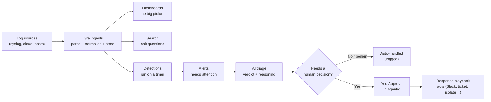
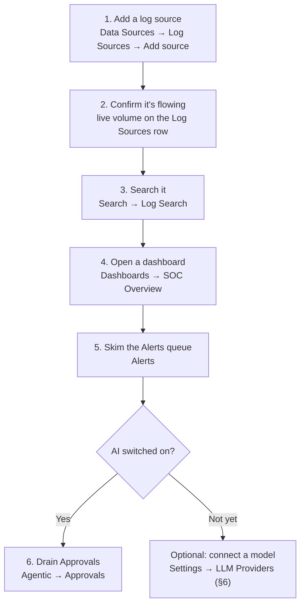
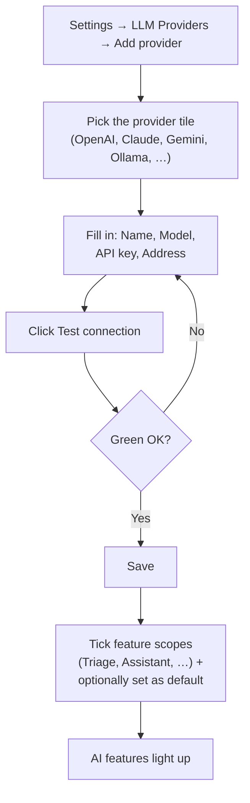
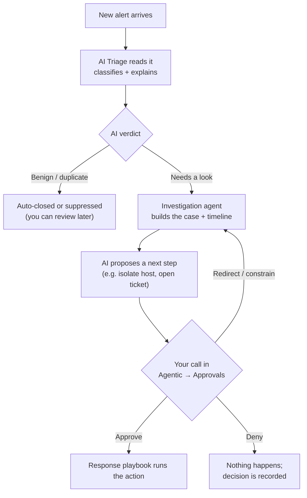

# Lyra — User guide

For the people who **use** Lyra day to day: analysts, hunters, and
responders working from the web UI. It assumes someone has already
installed the stack and given you a URL and a login — if you're the one
standing it up, that's covered by the installation and operations guides
in your deployment kit (ask your administrator, or contact
<info@trinelabs.ai>).

Everything here is done from the browser. You never need a terminal.

## Contents

1. [Logging in](#1-logging-in)
2. [Finding your way around](#2-finding-your-way-around)
3. [How an event becomes something you act on](#3-how-an-event-becomes-something-you-act-on)
4. [Your first 15 minutes](#4-your-first-15-minutes)
5. [The main surfaces](#5-the-main-surfaces)
6. [Turning on the AI (connecting an LLM provider)](#6-turning-on-the-ai-connecting-an-llm-provider)
7. [The AI analyst team](#7-the-ai-analyst-team)
8. [Getting help inside the app](#8-getting-help-inside-the-app)

---

## 1. Logging in

Open the URL your administrator gave you (typically
`http://<lyra-host>:8080`) and sign in. First-login credentials are set by
whoever installed Lyra.

Change your password straight away from the **top-right user menu →
Profile**. If your organisation uses single sign-on (LDAP / Active
Directory / OIDC), use the SSO button instead and skip password setup.

> **"Safe mode" banner across the top?** That means no licence is loaded
> yet — you can read and search everything, but creating or editing is
> disabled until an admin uploads a licence. Nothing you do is lost; it
> just waits. Ask your administrator.

---

## 2. Finding your way around

Everything lives behind one menu bar across the top of the screen. There
are no hidden corners — if you can see it in that bar, that's where it
lives. The menus are arranged left to right in the order a security team
actually works: **see what's happening → look at what needs attention →
dig in → decide → act → manage what feeds it → configure.** You click a
menu name to open its page, and menus with a small **▾** open a short
drop-down of related pages.

```
  Dashboards | Alerts | Search v | Detections v | Agentic v | Response v | Data Sources v | Settings v
  ---------------------------------------------------------------------------------------------------
   Dashboards   Alerts    Search      Detections    Agentic     Response     Data Sources   Settings
   the big      the       Log Search  Rules         Approvals   Workflows    Log Sources    Access
   picture      triage    Saved       Coverage      Agents      Schedules    Collectors     Knowledge
   (SOC / Log   queue     Searches                  Skills      Executions   Schema         LLM Providers
    / Custom)   (AI-      Entity                                 Integrations                System
               triaged)   View
```

Here's what each one is for, in plain terms:

- **Dashboards** — your home base and the big picture. Think of it like
  the dashboard of a car: at-a-glance charts and numbers showing how
  things are going — how many alerts, what's busiest, how much data is
  coming in. It opens on **SOC Overview**; **Log Overview** focuses on the
  data feeds, and you can build your **own** dashboards too.

- **Alerts** — the "needs a human to look" list. Whenever Lyra spots
  something worth attention, it lands here. If the AI is switched on, each
  item already arrives with a plain-language verdict ("looks benign",
  "worth investigating") and the reasoning behind it, so you're not
  starting from a blank page. This is where most analysts spend their day.

- **Search** — the "go find out" tool. When you have a question — *did
  this user log in from somewhere odd? what did this computer do last
  night?* — you ask it here. You can type a query (the language is called
  **OQL**, and the **Ask** button can write it for you from a plain
  sentence), re-run queries you've **Saved**, or open the **Entity View**,
  which gathers everything Lyra knows about one person, computer, or
  address onto a single page.

- **Detections** — the standing "watch for this" rules. These run on a
  timer in the background and are what create alerts. **Rules** is the
  list of them; **Coverage** shows, at a glance, what you're watching for
  versus the gaps — useful for spotting blind spots. You rarely need this
  on day one; the product ships with a set already switched on.

- **Agentic** — the AI assistants. Lyra includes a team of AI "analysts"
  that can read alerts, build a picture of what happened, and suggest what
  to do next. **Approvals** is the important one: it's your inbox of
  decisions the AI is waiting on *you* to confirm — nothing risky happens
  without your click. **Agents** shows the team and what each is doing;
  **Skills** are small, ready-made AI tasks you can run on demand. (If no
  AI is set up yet, see §6 — it's optional, and everything else works
  without it.)

- **Response** — the "do something about it" automation. A **Workflow**
  (also called a playbook) is a saved sequence of actions — for example,
  *post a message to Slack, open a ticket, and isolate the affected
  computer.* **Schedules** run playbooks on a timer, **Executions** is the
  history of what ran and whether it worked, and **Integrations** are the
  outside tools Lyra can act through (Slack, your ticketing system, your
  endpoint security tool, and so on). Playbooks can pause to ask a human
  for a yes/no in Slack before continuing.

- **Data Sources** — where your logs come in. **Log Sources** is the list
  of feeds you've connected and lets you add more (see §4). **Collectors**
  are small helper programs you install on other computers so they can
  send their logs in. **Schema** is the behind-the-scenes list of every
  field Lyra understands — most people never need to open it.

- **Settings** — the admin controls. If your account isn't an
  administrator, you may not see this at all, and that's normal. It holds
  **Access** (people, their permissions, and keys for other software),
  **Knowledge** (reusable building blocks for searches), **LLM Providers**
  (where you connect the AI — see §6), and **System** (the licence,
  backups, how long data is kept, and the audit trail of who did what).

Two helpers sit in the **top-right corner of every page**:

- **?  Help** — opens the built-in guides (searching, dashboards,
  detections, playbooks, the AI team, connecting data, and more). This is
  the fastest place to look something up without leaving the app.
- **Ask** — a question box. Type a question in ordinary English and it
  answers, or ask it to build a search for you. (It needs the AI to be
  switched on — see §6.)

You'll also notice a small **number badge** on **Agentic → Approvals**
when the AI is waiting on a decision. It follows you around every page, so
you'll never miss something that needs your sign-off.

---

## 3. How an event becomes something you act on

This is the path a log takes from arrival to action. The labels are the
actual menus above:

```
   a log source            Lyra ingest             what you see & do
  +-------------+        +----------------+       +-----------------------+
  | syslog      |        | parse -> OCSF  |       | Dashboards (overview) |
  | HTTP / HEC  | events | normalise      | query | Search     (dig in)   |
  | cloud API   |------->| store (fast    |------>| Alerts <-- Detections |
  | (S3,Okta..) |        |  columnar DB)  |       |   |        run on a    |
  | Collectors  |        +----------------+       |   v        schedule   |
  +-------------+                                 | Agentic: AI triages ->|
    Data Sources                                  |   you Approve ->      |
    -> Log Sources                                | Response: run a SOAR  |
    -> Add source                                 |   playbook            |
                                                   +-----------------------+
       Detections raise Alerts automatically; the AI team can triage,
       investigate, and -- only with your approval -- respond.
```

In words: sources send logs → Lyra parses them into one normalised schema
and stores them → you search and chart them, and scheduled **Detections**
raise **Alerts** → the AI team triages and proposes next steps → you
approve, and a **Response** playbook carries the action out.

As a flowchart (this renders as a diagram on GitHub and in most markdown
viewers; in a plain text editor you'll just see the labels):



---

## 4. Your first 15 minutes

The quickest path from a fresh login to seeing real data:



Step by step:

1. **Add a log source.** **Data Sources → Log Sources → Add source**, pick
   a kind (syslog, HTTP, AWS CloudTrail/S3, Okta, M365, Zscaler, Windows
   event channels, host file tail, …). Some kinds show a
   **delivery-method** sub-picker (e.g. Zscaler: Cloud NSS over HTTPS,
   Syslog via NSS VM, or S3 export). Fill the fields the wizard surfaces,
   optionally restrict senders with **Allowed CIDRs**, and **Save**. See
   §5 for the detail.
2. **Confirm it's flowing.** The **Log Sources** row shows live event
   volume within seconds. A yellow **Parser issues** chip means some lines
   didn't parse — click it to inspect.
3. **Search it.** **Search → Log Search**, run `*` over the last 15
   minutes, then narrow (e.g. `eventtype=failed_auth`). See §5 and the
   in-app **OQL** help.
4. **Look at the Overview dashboard.** **Dashboards → SOC Overview** for
   alert counts, top detections, and ingest volume.
5. **Skim the Alerts queue.** **Alerts** — if AI is on, items are already
   triaged with a verdict and reasoning.
6. *(If AI is enabled)* **Drain the Approvals inbox.** **Agentic →
   Approvals** — approve or deny what the AI is waiting on.

Optional, any time: install **Collectors** on other hosts, wire up
**Response → Integrations**, and (admins) turn on the AI team under
**Settings → LLM Providers** — see §6.

---

## 5. The main surfaces

### Search (OQL)

Lyra's query language is **OQL** — pipes, fields, and `stats`, very close
to Splunk's SPL, so most muscle memory transfers.

```oql
user="alice" eventtype=failed_auth
```

```oql
eventtype=failed_auth | stats count by user, src_ip | sort -count | head 20
```

- Space-separated filters are ANDed. Quote values with spaces.
- Set the **time window** on the search bar (15m / 1h / 24h / 7d / 30d /
  custom), **not** in the query body.
- Field synonyms auto-resolve (`host`, `dest_ip`, `index`, …) to the
  canonical field. The **Schema** page shows the canonical name and its
  synonyms.
- Click **Save** to keep a query as a **Saved Search**; from there,
  **Promote to Detection** turns it into a scheduled rule.
- Stuck? The **Ask** assistant drafts OQL from a plain-English question.

Full reference: in-app **Help → OQL**.

### Dashboards

Saved layouts of panels (single values, time-series, top-N tables, event
tables) over a time window.

- Bundled dashboards (Overview, Authentication, Endpoints, Network,
  Sources health) are read-only — **Clone** one to customise.
- **New dashboard** gives a blank canvas; each panel runs an OQL query.
- **Tokens** (e.g. `$host`) turn one dashboard into a per-host / per-user
  drill-down.
- Click any table cell or chart point to **drill down** into Log Search
  scoped to that value and time.

### Alerts

Your triage queue. Each alert carries severity, the detection that raised
it, the entities involved, and — if AI is on — a triage verdict with
reasoning and evidence. Open an alert to see the full incident drawer:
timeline, related alerts, linked workflow runs, notes, and the actions the
AI has proposed. Add context as **case notes** (agents read these as typed
evidence).

### Detections

- **Rules** — the detections that raise alerts. Build or edit one in the
  visual **Rule Builder**, or promote a saved search. Each rule has a
  schedule and its own time window.
- **Coverage** — what you're watching versus gaps, so you can see where to
  add rules.

Noisy rule? Open it and use the fine-tune tools to tighten the
false-positive rate.

### Data Sources

- **Log Sources → Add source** — the onboarding wizard (see §4). Use
  **Deploy to multiple hosts** to roll the same host-local feed (journald,
  file tail, Windows channels, …) across many collectors at once.
- **Collectors** — the fleet of lightweight daemons you install on other
  hosts to collect their logs. The one-command installer is here under
  **Deploy**.
- **Schema** — every field Lyra knows, whether it's promoted (fast,
  indexed) or still raw, plus the review queue for new parser/field
  candidates.

### Response (SOAR)

- **Workflows** — visual playbooks that act through your integrations.
  Trigger them from an alert, on a schedule, or by hand.
- **Executions** — run history, step by step.
- **Integrations** — the outbound connectors (Slack, ticketing, EDR, …)
  playbooks use. Human-in-the-loop steps can pause a workflow for a Slack
  approval and resume when someone clicks approve.

---

## 6. Turning on the AI (connecting an LLM provider)

The AI features — the analyst team, the triage verdicts on alerts, the
**Ask** box, "write my search for me" — all need a **language model**
(sometimes called an "LLM" or just "the AI"). Lyra doesn't ship one; you
point it at one. This is a one-time setup, and it's **optional** —
everything else (collecting logs, searching, dashboards, detections,
playbooks) works perfectly without it.

> This step is usually done by an administrator. If you don't see
> **Settings**, ask whoever set up your account.

### What you'll need first

Pick one of these — you only need one to start:

- **A cloud AI service** (easiest): an account and an **API key** from a
  provider such as OpenAI, Anthropic (Claude), Google (Gemini), DeepSeek,
  or Zhipu. The key is a long secret string you copy from that provider's
  website. Lyra will reach out to them over the internet.
- **A model running on your own network** (best for private or
  "air-gapped" sites, where the system has no internet): something like
  **Ollama**, or any service that speaks the common "OpenAI-compatible"
  format. No API key needed — just the address where it's running.
- **Amazon Bedrock**, if you run Lyra on AWS and prefer to use your cloud
  account's permissions instead of a key.

Lyra never sends your logs off-site unless you deliberately connect a
cloud model here. On a self-hosted model, nothing leaves your network at
all.

### Add a provider — step by step



1. Open **Settings → LLM Providers**.
2. Click **Add provider**.
3. **Pick who's providing the model.** You'll see tiles for OpenAI,
   Anthropic, Google Gemini, Ollama, DeepSeek, Zhipu, "OpenAI-compatible"
   (for any self-hosted service), and Amazon Bedrock. A one-line
   description under each helps you confirm you've picked the right one.
   Lyra fills in sensible defaults for the address and model once you
   choose.
4. **Fill in the details:**
   - **Name** — any label you'll recognise, e.g. "OpenAI (production)".
   - **Model** — which model to use (a default is pre-filled; change it if
     your provider gave you a specific model name).
   - **API key** — paste the secret key from your provider's website.
     *(Skip this for a self-hosted model like Ollama — none is needed. For
     Bedrock you can use your AWS role instead.)*
   - **Address / base URL** — pre-filled for the cloud services. For a
     self-hosted model, enter where it's running. (From inside Lyra,
     a model on the same machine is reached at
     `http://host.docker.internal:11434` for Ollama — the form suggests
     this for you.)
5. **Test it.** Click **Test connection**. Lyra does a quick round-trip to
   the model and tells you if it worked — a green "OK" means you're good,
   and a red message explains what to fix (wrong key, wrong model name,
   can't reach the address).
6. **Save.**

### Choosing what the AI is allowed to do

A provider does nothing until you tell Lyra *which features* it should
power. On the provider you can tick one or more **feature scopes** — for
example:

- **Triage agent** — the main one: have the AI read and classify each new
  alert.
- **Log Search** — let the **Ask** box turn plain English into a search.
- **Detection rules** — draft new detection rules from a description.
- **Assistant** — the top-right **Ask** helper.
- **Response workflows**, **Skills**, **Reporting**, and more — each
  explained by a short hint next to it.

Tip: mark one provider as the **default**. The default is used as a
sensible fall-back for anything you haven't specifically assigned, so you
don't have to tick every box to get started. A common first setup is: one
provider, set as default, with the **Triage agent** and **Assistant**
scopes ticked.

> **Enabling the Red Team agent:** this one adversarial agent is off until
> you route a provider to its **Red Team agent** scope. Ticking that box
> is the switch — the agent then turns itself on. Leave it unticked if
> you're not ready for it.

Once a provider is saved, tested, and scoped, the AI features light up
within a few moments — alerts start arriving with verdicts, the **Ask**
box answers, and the agents in §7 wake up. Changed your mind? Un-tick a
scope, disable the provider, or delete it; the rest of Lyra keeps running
unchanged.

---

## 7. The AI analyst team

Lyra ships a roster of **12 AI agents** (Red Team is off by default) that
classify alerts, build cases, hunt, tune detections, propose containment,
and report up. Find them under **Agentic**.

Here's how you and the AI share the work on a single alert — notice every
real-world action waits for your approval:



Key things to know as a user:

- **Agents aren't chatbots.** Each is a scoped, audited worker. You don't
  free-chat with them — you steer them with structured directives
  (redirect, constrain, prioritize, approve, deny) and leave context as
  **case notes**.
- **Nothing lands on a real asset without you.** Containment and other
  high-impact actions are proposals until a human approves them. Approve
  or deny from **Agentic → Approvals** (one click each; both are
  recorded).
- **Roster** (**Agentic → Agents**) shows each agent's live status.
  **Governance** shows what each agent is allowed to do, and the kill
  switches (per-capability, per-agent, and a plane-wide freeze).
- **Daily briefing** — the Reporting agent writes a morning/weekly summary
  (what was auto-closed, cases opened/closed, pending approvals, ingest
  health, cost). Read it at the start of a shift instead of opening the
  queue cold.

**If AI is turned off** (no model configured), the Agents page still
renders but the agents sit idle. Alerts still fire, detections still run,
dashboards still update — you just don't get the autonomous triage and
proposal layer. To turn it on, connect a model under **Settings → LLM
Providers** — see §6. See in-app **Help → Agents** for the full picture.

---

## 8. Getting help inside the app

- **? Help** (top-right) — the full in-app guide library: OQL, dashboards,
  detections, SOAR, agents, onboarding sources, collectors, and more.
- **Ask** (top-right) — ask a question in plain English or have it draft a
  search; answers are grounded in your deployment's help corpus.
- Admin / operations topics (installation, backup, upgrade, licence
  rotation, troubleshooting the stack) are covered by the installation and
  operations guides that ship inside your deployment kit — ask your
  administrator, or contact <info@trinelabs.ai>.
